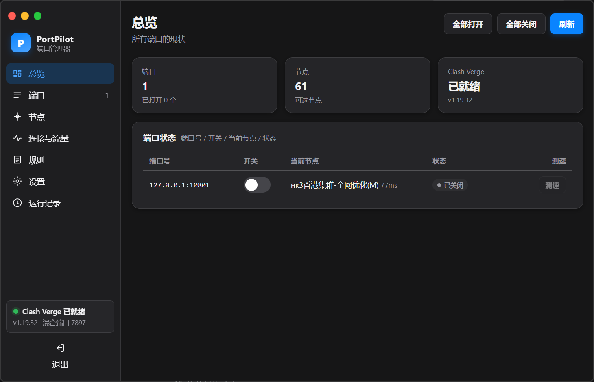

<p align="center"></p>

# PortPilot

不常驻的 Windows 桌面工具：把 Clash Verge Rev 里的节点各自开放成一个本地代理端口。

- **不常驻**：无托盘、无常驻服务、无定时轮询。打开即用，关窗即退出，不留残留进程。
- **只做三件事**：建/删端口、开/关、选节点。写配置与让内核应用都由工具在后台完成，不询问、不阻塞。
- **关窗后端口继续可用**：端口由 Clash Verge 的核听，工具退出不影响已打开的端口。
- **全文中文**，只使用「端口」「节点」「开关」三个概念；策略组只是实现细节，只在「规则」页只读展示。
- **单文件 exe**：界面与依赖全部内嵌，取 `PortPilot.exe` 一个文件即可运行，不需要旁边的 DLL 或 web 目录。
- **无边框窗口**：不显示系统标题栏，保留系统投影与 Win11 圆角；左上角是 13px 的红黄绿三个按钮（鼠标移上去才显示字形），按住侧栏顶条或品牌区可拖动窗口，四边与四角 6px 内可缩放，双击可最大化。

## 下载

下载 `PortPilot-v1.1-windows-amd64.exe`，双击运行，不需要安装，也不会在 exe 旁边生成任何文件。

> 首次运行未签名程序时，Windows 可能提示「无法验证发布者」，点「运行」即可；此后再打开不再提示。



## 从源码构建

在项目根目录执行：

```powershell
.\build.ps1            # 准备界面资源 -> 生成图标/版本资源 -> 编译 -> 校验 -> 自检
.\dist\PortPilot.exe   # 启动（单文件）
```

要求：Windows 10/11 + [Microsoft Edge WebView2 运行时](https://developer.microsoft.com/microsoft-edge/webview2/)（Win11 与装了 Edge 的机器都有）。
构建要求：Go 1.21+ 与 Windows PowerShell 5.1+；依赖优先用本机模块缓存，缺失时自动联网补齐。
不需要管理员权限，不会触发防火墙提示：所有端口只监听 `127.0.0.1`。

## 七个页面

| 页面 | 内容 |
| --- | --- |
| 总览 | 端口数/已打开数/节点数/Clash Verge 状态；端口表（端口号、开关、当前节点、状态、测速）；一键全部打开/关闭 |
| 端口 | 新建端口（一次多个：`10801,10802` 或 `10801-10805`，默认从 10801 起）、改端口号、开关、删除 |
| 节点 | 每个端口一个可搜索下拉（列出全部真实节点与延迟）、保存状态、单端口测速 |
| 连接与流量 | 按端口汇总活动连接与流量（快照式，手动刷新），可展开单端口连接明细 |
| 规则 | 只读展示内核当前的规则与策略组 |
| 设置 | 主题（跟随系统/浅色/深色）、测速地址、导入/导出配置、移除全部端口并还原、清空运行记录 |
| 运行记录 | 每次打开/关闭/选节点/测速的时间、端口、节点、结果与原因 |

## 工作原理（一句话）

- 每个端口 = 内核的一条 `listeners` 条目（`type: mixed`，只听 `127.0.0.1`）+ 一个同名 `select` 分组（成员含全部真实节点，已选节点排第一）。
- **选节点**：`PUT /proxies/PortPilot-<端口>`，即时生效，不写文件、不重载、不断开已有连接。
- **开/关**：把监听器写进一份完整配置文本，`PUT /configs` 交给内核应用；关掉的端口会真正停止监听。
- **持久保存**：同一份内容写进当前订阅的扩展模板（`option.merge` 与 `option.groups` 指向的文件），Clash Verge 每次重新生成配置都会带上它，所以重启 Verge 后端口与节点选择都还在。

细节与全部写入点见 [docs/PortPilot-设计说明.md](docs/PortPilot-设计说明.md)。

## 数据与备份

| 内容 | 位置 |
| --- | --- |
| 端口与设置 | `%APPDATA%\PortPilot\state.json` |
| 运行记录 | `%APPDATA%\PortPilot\run-log.jsonl` |
| 每次写入前的备份 | `%APPDATA%\PortPilot\backup\<时间戳>\` |
| 启动与错误日志 | `%APPDATA%\PortPilot\portpilot.log` |
| WebView2 数据（浏览器缓存） | `%APPDATA%\PortPilot.exe\`（WebView2 约定的位置） |
| 端口定义 | `<Verge 数据目录>\profiles\<option.merge 指向的文件>` |
| 每端口的分组 | `<Verge 数据目录>\profiles\<option.groups 指向的文件>` |

写入前一定先备份；应用失败会自动把模板还原，并把内核退回上一次成功的配置。
正常运行时 exe 旁边不会产生任何文件；只有当用户配置目录不可写（例如受限运行）时，日志与 WebView2 数据才会回退到 exe 同目录。

## 验证

```powershell
node --test                        # 35 项单元测试（配置组装、模板读写、状态归一化、选节点自愈）
.\dist\PortPilot.exe --selftest    # 宿主自检：内嵌资源、管道发现、内核握手、文件原子写与备份、端口探测、主题
node tests/e2e-pipeline.js 10801   # 真机端到端：真的开端口、代理流量、切节点、关闭、还原
```

真机验收已全部通过，包括：空状态建端口 → 打开 → 选节点 → 通过端口代理流量 → 关掉后真正停止监听 → 关窗后端口仍在 → 重启 Clash Verge 后端口与节点选择都还在。

## 不做的事

- 不写 Clash Verge 的全局 `Merge.yaml` / `Script.js`。
- 不读取、不解析、不依赖、不在界面提及任何既有的自定义脚本。
- 不做托盘、不做服务、不做开机自启、不做定时轮询。
- 不监听非回环地址，因此不触发防火墙提示、不需要管理员权限。

## 排查

| 现象 | 处理 |
| --- | --- |
| 状态栏显示「Clash Verge 未就绪」 | 启动 Clash Verge；工具会自动按 `production-` / `sidecar-release-` 变体与管道枚举找到内核 |
| 端口显示「打开失败」 | 端口号可能被别的程序占用，换一个端口号 |
| 端口显示「节点已失效」 | 订阅更新后节点改名了，到「节点」页重新选一个 |
| 想彻底退出 | 设置页「移除全部端口并还原」，或在端口页把端口删掉 |
